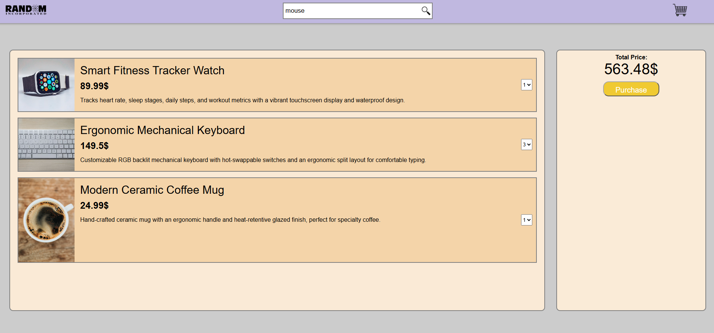
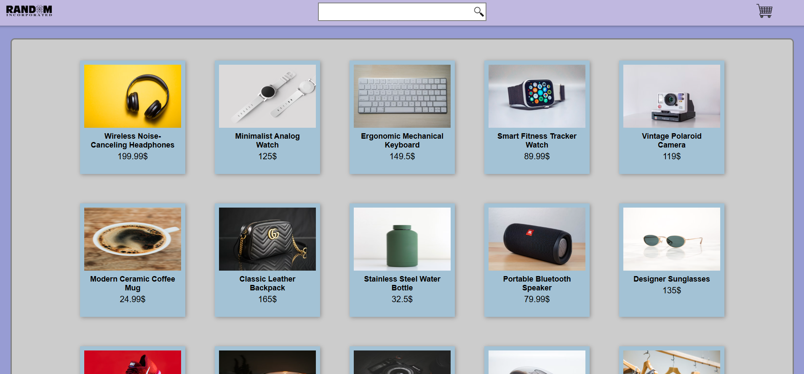
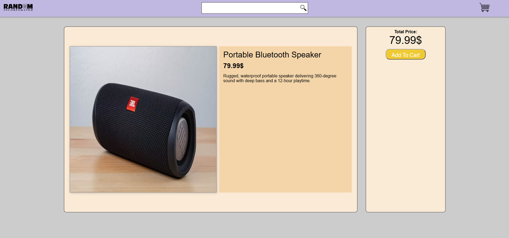
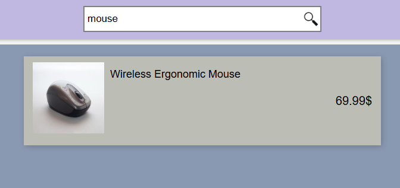

<div align="center">

# 🛒 Full-Stack E-Commerce Project

A responsive full-stack e-commerce web application featuring a React frontend and an Express backend.

[](https://reactjs.org/)
[](https://expressjs.com/)
[](https://opensource.org/licenses/MIT)

</div>

---

## ✨ Features At-a-Glance

<details>
<summary><b>Click to expand app features</b></summary>

* 📱 **Responsive Homepage:** Seamless browsing experience across all devices.
* 🔍 **Live Search:** Instantly find products by typing keywords.
* 📄 **Product Details View:** Click any item for full descriptions and info.
* 🛒 **Shopping Cart:** Add, remove, and review items in real time.

</details>

---

## 🛠️ How to Setup and Run

To run this application locally, you need to open **two separate terminals**.

### 1. Start the Back-End Server
In your first terminal, navigate to the `back-end` folder and start the server:

```bash
cd back-end
npm install
npm start
```
The server will run on http://localhost:3000.

### 2. Start the React App
In your second terminal, navigate to the `front-end` folder and start the development server:

```bash
cd front-end
npm install
npm start
```
The React app will open in your browser (usually at http://localhost:3001 or http://localhost:5173).

### ⚠️ Requirements
Make sure both terminals remain open while using the app.
Ensure CORS is enabled in your Express server to allow the React app to fetch data.





